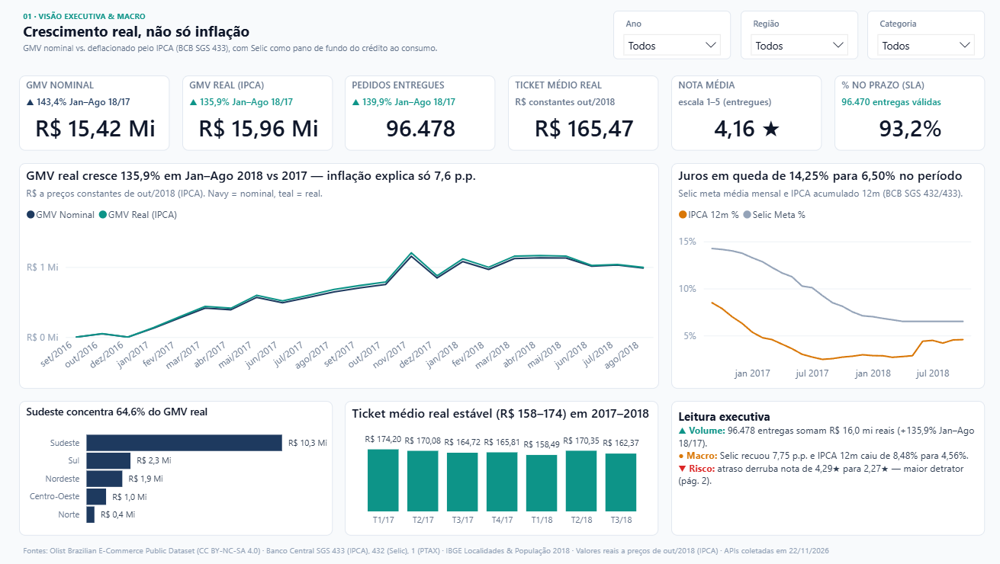

# Painel E-Commerce & Macroeconomia Brasil

Painel analítico em **Power BI (PBIP)** + **painel web interativo bilíngue (PT/EN)** que cruza **99.441 pedidos reais** do conjunto público da **Olist** (2016–2018) com séries oficiais das APIs públicas do **Banco Central do Brasil (SGS)** — IPCA, Selic e Dólar PTAX — e do **IBGE** — Localidades e População por UF.

🔗 **Painel web interativo (GitHub Pages):** [balchuna.github.io/painel-ecommerce-macro-br](https://balchuna.github.io/painel-ecommerce-macro-br/)



Outras páginas renderizadas no Power BI Desktop: [Logística, SLA & Cliente](docs/painel/2-logistica-sla.png) · [Comercial & Clientes](docs/painel/3-comercial-clientes.png) · [Qualidade & Linhagem](docs/painel/4-qualidade-linhagem.png).

O projeto responde a quatro perguntas de negócio com rigor auditável:

1. **Quanto do crescimento foi real?** Deflacionando o GMV pelo **IPCA acumulado (BCB SGS 433)** a preços constantes de out/2018, o GMV real cresceu **+135,87%** em Jan–Ago 2018 vs. Jan–Ago 2017 (contra +143,43% nominal — inflação explica apenas **7,56 p.p.**), enquanto a **Selic caiu de 14,25% para 6,50%**.
2. **Quanto o atraso logístico custa em satisfação?** Pedidos entregues no prazo (**93,23%**) recebem nota média **4,29★**; atrasados caem para **2,27★** (**-2,02★**), chegando a **1,67★–1,72★** com 8+ dias de atraso. Norte e Nordeste esperam **1,9× mais** que o Sudeste.
3. **Onde o e-commerce realmente penetra e onde a receita se concentra?** Normalizado pela população oficial do IBGE, **SP lidera com R$ 13.106 / 100 mil hab.** (18,7× acima do AM). **18 de 74 categorias** somam 80% do GMV, **top 10% dos vendedores** geram **66,34%** da receita, **78,46%** do GMV ocorre no cartão (**67,92%** parcelados, média **3,55x**) e a recompra é de apenas **3,00%**.
4. **Que anomalias reais existem na base?** **13 regras de auditoria** rastreiam **6.420 ocorrências** (2.963 pedidos não entregues, 551 reviews duplicadas, 546 fretes extremos, 8 entregues sem data real, 6 cancelados com data espúria), sem descartar nada em silêncio.

Todo número exibido no Power BI e no painel web sai de um **gabarito em SQL** (`sql/gabarito/*.csv`), é recalculado de forma independente em **pandas** nos testes automatizados e é conferido diretamente dentro do motor **Analysis Services (TOM/DAX)** do Power BI Desktop.

Para entender sem jargão, leia [docs/COMO-FUNCIONA.md](docs/COMO-FUNCIONA.md). O modelo estrela está em [docs/MODELO.md](docs/MODELO.md), o sistema visual em [docs/DESIGN_SPEC.md](docs/DESIGN_SPEC.md), as decisões técnicas em [docs/DECISOES.md](docs/DECISOES.md) e dez perguntas de entrevista em [docs/ESTUDO.md](docs/ESTUDO.md).

## English summary

An end-to-end **Power BI (PBIP)** + **live bilingual (PT/EN) interactive web dashboard** combining **99,441 real public Brazilian e-commerce orders (Olist, 2016–2018)** with live official public APIs from **Banco Central do Brasil (SGS)** — IPCA inflation (433), Selic policy rate (432), USD PTAX (1) — and **IBGE** (states and population).

- **Live interactive dashboard:** [https://balchuna.github.io/painel-ecommerce-macro-br/](https://balchuna.github.io/painel-ecommerce-macro-br/)
- **Real vs. nominal growth:** Deflating nominal GMV (`R$ 15.42M`) by cumulative IPCA to constant Oct/2018 BRL (`R$ 15.96M`) proves like-for-like Jan–Aug 2018 vs. 2017 growth was **+135.87% real** (+143.43% nominal; inflation explains only **7.56 p.p.**) as Selic dropped from **14.25%** to **6.50%**.
- **Logistics SLA & customer satisfaction:** Across 96,470 delivered orders with valid timestamps (**93.23%** on-time), late delivery crashes average review score from **4.29★** to **2.27★** (**-2.02★**, plunging to **1.67★–1.72★** at 8+ days late). North & Northeast customers wait **1.9× longer** than the Southeast.
- **Commercial concentration & data quality:** **18 of 74 categories** drive 80% of GMV, the **top 10% sellers** generate **66.34%** of real GMV, credit card accounts for **78.46%** of GMV (**67.92%** in installments, avg **3.55x**), and repeat-buyer rate is **3.00%**. **13 explicit quality rules** audit **6,420 real dataset anomalies** (duplicate reviews, missing timestamps, extreme freight) with zero silent drops.
- **Engineering & verification:** Star-schema galaxy model (2 fact tables, 6 conformed dimensions, 9 single-direction active relationships), **68 DAX measures**, deterministic Python-generated PBIP (TMDL + PBIR), 6 SQLite answer-key queries independently reconciled in pandas and verified inside Power BI Desktop's local Analysis Services engine.

## Fontes de dados reais e atribuições

Nenhum dado deste projeto é sintético. Todas as fontes são públicas e coletadas sem chaves privadas por [`scripts/coletar_dados.py`](scripts/coletar_dados.py), com registro de URL, timestamp UTC e hash SHA-256 em `data/limpa/fontes_metadados.csv`:

| Fonte | Endpoints / Arquivos | Escopo | Licença |
|---|---|---|---|
| **Olist** | 8 CSVs oficiais (`olist/work-at-olist-data`, espelho Kaggle) | 99.441 pedidos, 112.650 itens, 103.886 pagamentos, 99.224 reviews, 3.095 vendedores | CC BY-NC-SA 4.0 |
| **Banco Central (SGS)** | Séries `433` (IPCA), `432` (Selic meta) e `1` (PTAX USD) | Histórico `2015-10` a `2018-10` + retrato macro recente | Dados Públicos Oficiais (LAI) |
| **IBGE** | Localidades (`/v1/localidades/estados`) + SIDRA `6579` (Est. 2018) e `4714` (Censo 2022) | 27 UFs, 5 macrorregiões e população oficial | Dados Públicos Oficiais |

## Principais achados verificados (gabarito SQL)

Todos os números abaixo saem diretamente de `sql/gabarito/01_visao_executiva.csv` a `06_qualidade_dados.csv` (base: pedidos entregues `flag_entregue = 1`; valores reais em R$ constantes de `2018-10` pelo IPCA):

### 1. Visão executiva & macro (`01_visao_executiva.csv`)

| Indicador | Valor verificado |
|---|---:|
| Pedidos brutos (Olist) | 99.441 |
| Pedidos entregues analisados (`flag_entregue = 1`) | 96.478 (97,02%) |
| Pedidos entregues com data real válida (base SLA) | 96.470 |
| Pedidos não entregues excluídos da análise comercial | 2.963 (2,98%) |
| GMV Nominal entregue (produtos + frete) | R$ 15.424.463,65 |
| GMV Real IPCA (a preços de out/2018) | R$ 15.964.483,56 |
| Frete nominal (% do GMV nominal) | R$ 2.202.965,54 (14,28%) |
| Ticket médio real / Itens por pedido | R$ 165,47 / 1,14 |
| Crescimento YoY homogêneo Jan–Ago 2018 vs. 2017 (Nominal / Real) | +143,43% / +135,87% (inflação: 7,56 p.p.) |
| Selic meta média (set/2016 → out/2018) | 14,25% → 6,50% a.a. |
| IPCA acumulado 12 meses (set/2016 → out/2018) | 8,48% → 4,56% |
| Prazo médio de entrega / Entregas no prazo | 12,50 dias / 93,23% |
| Nota média geral (no prazo vs. atrasado) | 4,16★ (4,29★ vs. 2,27★ · queda de -2,02★) |
| Cartão de crédito (% pedidos / % GMV / % parcelados / média) | 75,48% / 78,46% / 67,92% / 3,55x |
| Clientes únicos entregues / Recompra (total / até 6 meses) | 93.358 / 3,00% (2.801) / 1,36% |
| Vendedores ativos / Participação Top 10% (`D1`) | 2.970 / 66,34% do GMV real |
| Categorias que somam 80% do GMV (Pareto) | 18 de 74 (81,34% acumulado) |

### 2. Impacto do atraso na avaliação do cliente (`04_atraso_vs_avaliacao.csv`)

| Faixa de atraso | Pedidos | % Base SLA | Nota média | Delta vs. no prazo | % Nota 5★ | % Nota 1★ |
|---|---:|---:|---:|---:|---:|---:|
| No prazo / antecipado | 89.936 | 93,23% | **4,29★** | 0,00★ | 62,26% | 6,62% |
| 1–3 dias de atraso | 1.870 | 1,94% | **3,29★** | -1,00★ | 33,15% | 25,11% |
| 4–7 dias | 1.802 | 1,87% | **2,10★** | -2,19★ | 14,13% | 58,58% |
| 8–14 dias | 1.478 | 1,53% | **1,67★** | -2,62★ | 6,85% | 70,61% |
| 15+ dias | 1.384 | 1,43% | **1,72★** | -2,57★ | 7,19% | 69,06% |

### 3. Penetração per capita (IBGE 2018) e SLA — extremos (`03_logistica_sla_uf.csv`)

| Rank | UF | Região | Pedidos | GMV Real / 100 mil hab. | Prazo (d) | % No prazo | Nota |
|---:|---|---|---:|---:|---:|---:|---:|
| 1 | SP | Sudeste | 40.501 | R$ 13.106,47 | 8,70 | 95,51% | 4,25★ |
| 2 | RJ | Sudeste | 12.350 | R$ 12.415,10 | 15,24 | 87,89% | 3,97★ |
| 3 | DF | Centro-Oeste | 2.080 | R$ 12.045,07 | 12,90 | 94,33% | 4,13★ |
| 4 | MG | Sudeste | 11.354 | R$ 8.950,76 | 11,94 | 95,43% | 4,19★ |
| 5 | SC | Sul | 3.546 | R$ 8.705,96 | 14,90 | 91,79% | 4,13★ |
| 25 | AP | Norte | 67 | R$ 2.017,25 | 27,18 | 97,01% | 4,24★ |
| 26 | RR | Norte | 41 | R$ 1.610,71 | 29,34 | 87,80% | 3,90★ |
| 27 | AM | Norte | 145 | R$ 700,71 | 26,36 | 97,24% | 4,24★ |

## Pacote Power BI (PBIP) e 4 páginas

O projeto do Power BI em [`powerbi/PainelEcommerceMacro.pbip`](powerbi/PainelEcommerceMacro.pbip) (TMDL + PBIR v2.4.0) é gerado de forma determinística por [`scripts/montar_pbip.py`](scripts/montar_pbip.py) a partir de:

- **Modelo semântico:** [docs/MODELO.md](docs/MODELO.md) — 12 tabelas (2 fatos, 6 dimensões, 3 auditoria/metadados e `Medidas`) e 9 relacionamentos `*:1` ativos em direção única.
- **Medidas DAX:** [`dax/medidas.dax`](dax/medidas.dax) — 68 medidas organizadas em 6 pastas (Receita & Macro, Inteligência Temporal MoM/YoY/MM3m/Acumulado, Logística & SLA/IBGE, Comercial/Pareto/Coorte/Vendedores, Qualidade e Formatação Dinâmica).
- **Tema e layout:** [`tema/tema.json`](tema/tema.json) e [docs/DESIGN_SPEC.md](docs/DESIGN_SPEC.md) — grade editorial 1280×720, margem 24 px, gutter 16 px e zero sobreposição de visuais nas 4 páginas:
  1. **Visão Executiva & Macro** (`visao_executiva`)
  2. **Logística, SLA & Cliente** (`logistica_sla`)
  3. **Comercial & Clientes** (`comercial`)
  4. **Qualidade & Linhagem** (`qualidade`)

## Como reproduzir

Testado em Python 3.13 (Windows) e em CI no Ubuntu (Python 3.11 e 3.13) e Windows (Python 3.13). Os CSVs modelados (`data/limpa/`), os gabaritos (`sql/gabarito/`) e o JSON do painel web (`docs/dados/resumo.json`) já estão versionados para testes 100% offline.

```bash
pip install -r requirements.txt
```

Para refazer toda a coleta pública, modelagem, gabarito SQL, JSON web e projeto PBIP do zero:

```bash
python scripts/coletar_dados.py
python scripts/limpar_modelar.py
python scripts/gerar_gabarito.py
python scripts/exportar_web_json.py
python scripts/montar_pbip.py
```

Para rodar a suíte de testes automatizados (offline-safe):

```bash
python -m pytest -q
```

### Abrir e atualizar no Power BI Desktop localmente

O `powerbi/` versionado traz um caminho de exemplo no parâmetro `PastaDados` (`C:\caminho\do\projeto\data\limpa`) para não expor caminhos pessoais. Para abrir e atualizar no seu computador, gere uma cópia fora do repositório apontando para a sua pasta `data/limpa`:

```bash
python scripts/montar_pbip.py --pasta-dados "D:\Repos\painel-ecommerce-macro-br\data\limpa" --saida ../painel-ecommerce-local
```

Depois abra `../painel-ecommerce-local/PainelEcommerceMacro.pbip` no Power BI Desktop e clique em **Atualizar**. Com o Power BI Desktop instalado no Windows, os testes end-to-end também abrem o projeto, atualizam via TOM e conferem as medidas DAX contra o SQL:

```bash
python -m pytest -q --desktop -m desktop
```

## Estrutura do repositório

```text
scripts/
  coletar_dados.py          coleta Olist + BCB SGS + IBGE com rate-limit e SHA-256
  limpar_modelar.py         deflator IPCA, 13 regras de qualidade e star schema CSV
  gerar_gabarito.py         carrega SQLite com constraints e gera sql/gabarito/*.csv
  exportar_web_json.py      exporta docs/dados/resumo.json reconciliado com o SQL
  montar_pbip.py            gera powerbi/PainelEcommerceMacro.pbip (TMDL + PBIR)
  exportar_painel.py        renderiza PNGs em alta definição a partir do PDF do Power BI
src/                        módulos de constantes, cliente HTTP, deflator IPCA e categorias
data/limpa/                 11 CSVs limpos do modelo estrela (UTF-8 LF)
sql/
  01_tabelas.sql            DDL SQLite com chaves estrangeiras e CHECK constraints
  02_views.sql              6 views analíticas reutilizáveis
  consultas/01..06.sql      6 consultas gabarito com CTEs e Window Functions
  gabarito/*.csv            resultados oficiais verificados por pandas e DAX
dax/medidas.dax             68 medidas DAX documentadas + consulta EVALUATE de conferência
tema/tema.json              tema editorial Power BI (espelhado em docs/styles.css)
powerbi/                    projeto Power BI (PBIP) gerado por scripts/montar_pbip.py
docs/
  index.html, styles.css, app.js   painel web interativo (GitHub Pages, 4 páginas, PT/EN)
  dados/resumo.json         agregações pré-calculadas para o painel web
  DESIGN_SPEC.md            sistema visual, tokens e coordenadas exatas 1280×720
  MODELO.md                 modelo estrela, colunas e 9 relacionamentos
  COMO-FUNCIONA.md          explicação de negócio sem jargão
  DECISOES.md               escolhas de engenharia e metodologia
  ESTUDO.md                 10 perguntas e respostas de entrevista técnica
tests/                      suíte pytest (offline, SQL vs. pandas, PBIP/TOM, web e Desktop)
.github/workflows/ci.yml    CI em Ubuntu (3.11, 3.13) e Windows (3.13)
```

## Limitações honestas

- **Recorte histórico:** os pedidos da Olist cobrem setembro/2016 a outubro/2018 (com meses cheios de jan/2017 a ago/2018). Os dados recentes do BCB (`macro_benchmark_atual.csv`) servem apenas como contraste macroeconômico atual, nunca como projeção de vendas.
- **Diferença de R$ 0,36 entre grão de pedido e grão de item:** `fato_pedidos` soma `R$ 15.964.483,56` em GMV real, enquanto `fato_itens_pedido` soma `R$ 15.964.483,20` devido ao arredondamento de centavos do deflator aplicado individualmente a 110.197 itens (0,000002%).
- **Prazo estimado com folga:** a taxa de 93,23% no prazo mede cumprimento em relação à data prometida pela Olist ao cliente, que historicamente já incluía folga média de ~13,5 dias nos pedidos entregues no prazo.
- **CI sem Power BI Desktop:** nas máquinas do GitHub Actions, os testes que exigem `Microsoft.PowerBI.Tabular.dll` ou a abertura do Desktop são pulados automaticamente (`-rs` registra o motivo no log) e rodam integralmente no Windows local.

## Licença e créditos

Código sob licença [MIT](LICENSE).

- **Dados de e-commerce:** Olist Brazilian E-Commerce Public Dataset (CC BY-NC-SA 4.0).
- **Dados macroeconômicos e demográficos:** Banco Central do Brasil (SGS) e IBGE — dados públicos oficiais.
- Power BI e Power Query são marcas da Microsoft; este projeto independente não possui vínculo com a Microsoft, Olist, Banco Central ou IBGE.
