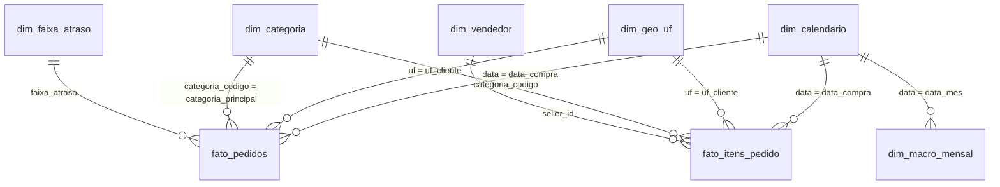

# Modelo de dados do painel

O painel usa um **modelo em estrela com duas tabelas de fatos conformadas** (constelação de fatos / *Galaxy Star Schema*): `fato_pedidos` (grão de pedido, 99.441 linhas) e `fato_itens_pedido` (grão de item vendido, 112.650 linhas) compartilham as dimensões conformadas `dim_calendario`, `dim_geo_uf` e `dim_categoria`. As medidas estão em [`dax/medidas.dax`](../dax/medidas.dax) e o projeto Power BI (PBIP) é gerado por [`scripts/montar_pbip.py`](../scripts/montar_pbip.py).

`qualidade_auditoria`, `fontes_metadados`, `macro_benchmark_atual` e `Medidas` ficam desconectadas no modelo semântico (ver seção *Por que o modelo é assim*).

## Tabelas

As colunas marcadas com `*` são derivadas no Power Query a partir dos CSVs de [`data/limpa/`](../data/limpa) para simplificar rótulos, ordenação e formatação nos visuais. As demais correspondem 1-para-1 aos arquivos de `data/limpa/`.

### `dim_calendario`

Um dia por linha cobrindo toda a janela Olist (`2016-09-01` a `2018-10-31`, 791 dias). Marcada como tabela de datas oficial (`dataCategory: Time`) pela coluna `data`.

| Coluna | Tipo | O que é |
|---|---|---|
| `data` | data | chave primária (`isKey`); tabela de datas |
| `ano` | número inteiro | 2016, 2017 ou 2018 (filtro global do cabeçalho) |
| `trimestre` | texto | rótulo `AAAA-Tn`; classificado por `trimestre_num` |
| `trimestre_num` | número inteiro | ordenação numérica do trimestre (oculta) |
| `mes` | número inteiro | 1 a 12 |
| `ano_mes` | texto | `AAAA-MM`; classificado por `ano_mes_num` |
| `ano_mes_num` | número inteiro | ordenação `AAAAMM` (oculta) |
| `mes_ano_pt` | texto | `set/2016`..`out/2018`; classificado por `ano_mes_num` |
| `dia_semana` | número inteiro | 1 (segunda) a 7 (domingo) |
| `eh_fim_de_semana` | número inteiro | 1 = sábado/domingo, 0 = dia útil |
| `trimestre_curto`* | texto | `T1/17`..`T3/18`; classificado por `trimestre_num` |

### `dim_macro_mensal`

Série mensal oficial do Banco Central do Brasil (SGS 433 IPCA, 432 Selic meta e 1 PTAX USD), de `2016-09` a `2018-10` (26 meses).

| Coluna | Tipo | O que é |
|---|---|---|
| `ano_mes` | texto | `AAAA-MM` |
| `data_mes` | data | 1º dia do mês (`AAAA-MM-01`); liga em `dim_calendario[data]` |
| `ipca_mensal_pct` | número decimal | variação mensal do IPCA (%) |
| `ipca_acum_12m_pct` | número decimal | IPCA acumulado em 12 meses (%) |
| `indice_ipca_base100` | número decimal | índice encadeado com `2018-10 = 100` |
| `fator_deflator` | número decimal | fator que traz o valor nominal para R$ constantes de `2018-10` |
| `selic_media` | número decimal | média mensal da meta Selic (% a.a.) |
| `ptax_media` | número decimal | média mensal do dólar PTAX venda (R$/US$) |

### `dim_geo_uf`

As 27 Unidades da Federação (API de Localidades + SIDRA População IBGE).

| Coluna | Tipo | O que é |
|---|---|---|
| `uf` | texto | sigla da UF (chave) |
| `codigo_ibge` | número inteiro | código oficial IBGE da UF |
| `nome` | texto | nome completo da UF |
| `regiao_sigla` | texto | `N`, `NE`, `CO`, `SE`, `S` |
| `regiao` | texto | macrorregião IBGE (filtro global do cabeçalho) |
| `populacao_ibge` | número inteiro | estimativa oficial IBGE 2018 (contemporânea à Olist) |
| `populacao_censo_2022` | número inteiro | Censo Demográfico IBGE 2022 (referência recente) |

### `dim_categoria`

74 categorias de produto (71 com tradução oficial Olist, 2 com fallback explícito e `sem_categoria`).

| Coluna | Tipo | O que é |
|---|---|---|
| `categoria_codigo` | texto | chave canônica em snake_case |
| `categoria_pt` | texto | nome legível em português (filtro global do cabeçalho) |
| `categoria_en` | texto | nome em inglês |
| `traducao_oficial_olist` | número inteiro | 1 = presente no CSV oficial da Olist, 0 = fallback |

### `dim_faixa_atraso`

Escala ordinal de atraso logístico (5 faixas entregues + `Sem entrega`).

| Coluna | Tipo | O que é |
|---|---|---|
| `faixa_atraso` | texto | rótulo PT-BR; classificado por `ordem` |
| `faixa_atraso_en` | texto | rótulo em inglês |
| `ordem` | número inteiro | 1 a 6 (oculta) |
| `eh_atrasado` | número inteiro | 1 = atrasou (`ordem` 2..5), 0 = no prazo ou sem entrega |

### `dim_vendedor`

3.095 vendedores Olist, classificados em decis de receita real entregue (`D1` = top 10% vendedores).

| Coluna | Tipo | O que é |
|---|---|---|
| `seller_id` | texto | identificador do vendedor (chave) |
| `uf_vendedor` | texto | UF de origem do vendedor |
| `cidade_vendedor` | texto | município do vendedor |
| `gmv_real_entregue` | número decimal | GMV real entregue acumulado do vendedor |
| `pedidos_entregues` | número inteiro | contagem de pedidos entregues |
| `decil_ordem` | número inteiro | 1 (`D1`) a 10 (`D10`), 11 = sem entrega (oculta) |
| `decil_gmv` | texto | `D1`..`D10` ou `Sem entrega`; classificado por `decil_ordem` |

### `fato_pedidos`

Uma linha por pedido bruto da base Olist (99.441 linhas, sem descarte silencioso). Pedidos não entregues ficam com `flag_entregue = 0` e são filtrados explicitamente nas medidas comerciais e de SLA.

| Coluna | Tipo | O que é |
|---|---|---|
| `order_id` | texto | chave primária do pedido |
| `data_compra` | data | data do pedido; liga em `dim_calendario[data]` |
| `ano_mes` | texto | `AAAA-MM` da compra |
| `data_aprovacao` | data | data de aprovação do pagamento (pode ser vazia) |
| `data_entrega_estimada` | data | data estimada informada ao cliente |
| `data_entrega_real` | data | data real de entrega ao cliente (vazia se não entregue) |
| `dias_entrega` | número inteiro | dias corridos entre compra e entrega real |
| `dias_atraso` | número inteiro | `data_entrega_real - data_entrega_estimada` (negativo = adiantado) |
| `flag_atraso` | número inteiro | 1 = atrasou (>0 dias), 0 = no prazo/antecipado, vazio = sem entrega |
| `faixa_atraso` | texto | liga em `dim_faixa_atraso[faixa_atraso]` |
| `status` | texto | status original Olist (`delivered`, `canceled`, `shipped`, ...) |
| `flag_entregue` | número inteiro | 1 = `delivered`, 0 = demais status |
| `uf_cliente` | texto | liga em `dim_geo_uf[uf]` |
| `categoria_principal` | texto | categoria de maior valor no pedido; liga em `dim_categoria[categoria_codigo]` |
| `nota_review` | número inteiro | avaliação do cliente (1 a 5; deduplicada pela mais recente) |
| `qtd_itens` | número inteiro | número de itens no pedido |
| `valor_produtos` | número decimal | soma do preço dos itens (R$ nominal) |
| `valor_frete` | número decimal | soma do frete dos itens (R$ nominal) |
| `valor_total_nominal` | número decimal | `valor_produtos + valor_frete` (R$ nominal) |
| `valor_total_real_ipca` | número decimal | `valor_total_nominal * fator_deflator` (R$ constantes out/2018) |
| `tipo_pagamento_principal` | texto | meio de pagamento dominante (`credit_card`, `boleto`, ...) |
| `parcelas` | número inteiro | número de parcelas do pagamento principal |
| `cliente_unico_id` | texto | identificador persistente do comprador (`customer_unique_id`) |
| `coorte_mes` | texto | mês (`AAAA-MM`) da primeira compra entregue do cliente |
| `meses_desde_coorte` | número inteiro | meses decorridos desde a coorte (0 = 1ª compra, 1 = M+1, ...) |
| `flag_recompra` | número inteiro | 1 = cliente possui 2+ pedidos entregues |
| `flag_frete_outlier` | número inteiro | 1 = pedido contém item com frete > R$ 300 ou > 2× preço |
| `tipo_pagamento_pt`* | texto | rótulo legível PT-BR (`Cartão de Crédito`, `Boleto Bancário`, ...) |
| `faixa_parcelas`* | texto | `1x`..`9x`, `10x+` ou `Sem info`; classificado por `faixa_parcelas_ordem` |
| `faixa_parcelas_ordem`* | número inteiro | ordenação 0..10 (oculta) |
| `mes_coorte_label`* | texto | `M0`, `M+1`, `M+2`, ...; classificado por `meses_desde_coorte` |
| `coorte_mes_num`* | número inteiro | `AAAAMM` numérico da coorte (oculta, usado no filtro da matriz) |

### `fato_itens_pedido`

Uma linha por item de pedido (112.650 linhas). Sustenta o Pareto de categorias e a concentração de receita por decil de vendedores sem dupla contagem.

| Coluna | Tipo | O que é |
|---|---|---|
| `order_id` | texto | identificador do pedido |
| `order_item_id` | número inteiro | sequência do item no pedido |
| `data_compra` | data | liga em `dim_calendario[data]` |
| `ano_mes` | texto | `AAAA-MM` da compra |
| `status` | texto | status do pedido |
| `flag_entregue` | número inteiro | 1 = entregue, 0 = demais |
| `uf_cliente` | texto | liga em `dim_geo_uf[uf]` |
| `categoria_codigo` | texto | liga em `dim_categoria[categoria_codigo]` |
| `seller_id` | texto | liga em `dim_vendedor[seller_id]` |
| `uf_vendedor` | texto | UF do vendedor |
| `preco` | número decimal | preço do item (R$ nominal) |
| `frete` | número decimal | frete do item (R$ nominal) |
| `valor_item_nominal` | número decimal | `preco + frete` (R$ nominal) |
| `valor_item_real_ipca` | número decimal | `valor_item_nominal * fator_deflator` (R$ out/2018) |
| `flag_frete_outlier` | número inteiro | 1 = frete extremo (> R$ 300 ou > 2× preço) |

### `qualidade_auditoria`

As 13 regras de qualidade e anomalias reais detectadas na base Olist (página 4).

| Coluna | Tipo | O que é |
|---|---|---|
| `regra_id` | texto | código único (`Q01`..`Q13`) |
| `regra` | texto | descrição da anomalia em PT-BR |
| `regra_en` | texto | descrição em inglês |
| `tabela_origem` | texto | arquivo CSV bruto onde a anomalia ocorre |
| `linhas_afetadas` | número inteiro | quantidade de registros afetados |
| `base_referencia` | número inteiro | denominador da tabela de origem |
| `pct_base` | número decimal | percentual sobre a base de referência (em pontos percentuais) |
| `severidade` | texto | categoria de impacto (`Exclusão analítica`, `Ajuste / Limpeza`, ...) |
| `tratamento` | texto | ação determinística aplicada em PT-BR |
| `tratamento_en` | texto | ação aplicada em inglês |
| `pct_base_frac`* | número decimal | `pct_base / 100` para exibição nativa `0.00%` |
| `tabela_curta`* | texto | nome resumido do CSV de origem (`orders.csv`, `items.csv`, ...) |
| `tipo_curto`* | texto | rótulo conciso de severidade para a tabela de auditoria |

### `fontes_metadados`

Linhagem completa dos 17 arquivos coletados (Olist, BCB SGS e IBGE), com URL, contagem de registros, SHA-256, timestamp UTC e licença.

| Coluna | Tipo | O que é |
|---|---|---|
| `arquivo` | texto | nome do arquivo bruto coletado |
| `fonte` | texto | `Olist`, `Banco Central (SGS)` ou `IBGE` |
| `endpoint` | texto | URL pública oficial utilizada |
| `registros` | número inteiro | total de registros lidos |
| `bytes_total` | número inteiro | tamanho em bytes |
| `sha256` | texto | hash criptográfico para reprodutibilidade |
| `coletado_em_utc` | texto | timestamp ISO-8601 UTC da coleta |
| `licenca` | texto | licença / atribuição oficial da fonte |
| `coletado_data`* | texto | data `AAAA-MM-DD` extraída de `coletado_em_utc` |
| `licenca_curta`* | texto | rótulo conciso da licença para a tabela da página 4 |
| `arquivo_curto`* | texto | nome resumido do arquivo para exibição sem corte |

### `macro_benchmark_atual`

Retrato recente (IPCA 12m, Selic meta e Dólar PTAX via BCB SGS) para contexto frente ao fim do recorte Olist (`2018-10`).

| Coluna | Tipo | O que é |
|---|---|---|
| `indicador` | texto | chave do indicador |
| `nome_pt` | texto | nome em português |
| `nome_en` | texto | nome em inglês |
| `serie_sgs` | número inteiro | código da série no BCB SGS (433, 432 ou 1) |
| `data_referencia` | data | data da leitura recente |
| `valor_recente` | número decimal | valor recente observado no BCB |
| `valor_fim_olist` | número decimal | valor em outubro/2018 |
| `unidade` | texto | unidade de exibição |

### `Medidas`

Tabela vazia com uma única coluna oculta (`oculta`), usada exclusivamente para agrupar todas as medidas DAX em pastas de exibição no Power BI.

| Coluna | Tipo | O que é |
|---|---|---|
| `oculta` | texto | coluna técnica oculta |

## Relacionamentos

Todos os nove relacionamentos são de **muitos para um (`*:1`)**, **ativos** e com **filtro em direção única** (da dimensão para a tabela fato ou série mensal). Nenhuma relação bidirecional é usada.

| Muitos | Um | Por quê |
|---|---|---|
| `fato_pedidos[data_compra]` | `dim_calendario[data]` | inteligência temporal (MoM, YoY, MM3m) e filtro global de ano |
| `fato_pedidos[uf_cliente]` | `dim_geo_uf[uf]` | penetração por 100 mil habitantes (IBGE) e filtro global de região |
| `fato_pedidos[categoria_principal]` | `dim_categoria[categoria_codigo]` | filtro global de categoria aplicado aos KPIs de pedidos |
| `fato_pedidos[faixa_atraso]` | `dim_faixa_atraso[faixa_atraso]` | ordenação fixa das 5 faixas de atraso no visual-herói da página 2 |
| `fato_itens_pedido[data_compra]` | `dim_calendario[data]` | sincroniza ano/período entre pedidos, categorias e vendedores |
| `fato_itens_pedido[uf_cliente]` | `dim_geo_uf[uf]` | sincroniza filtro global de região nos visuais de categoria e vendedor |
| `fato_itens_pedido[categoria_codigo]` | `dim_categoria[categoria_codigo]` | Pareto de categorias em grão real de item (sem distorcer pedidos multi-categoria) |
| `fato_itens_pedido[seller_id]` | `dim_vendedor[seller_id]` | concentração de GMV real por decil de vendedores (`D1`..`D10`) |
| `dim_macro_mensal[data_mes]` | `dim_calendario[data]` | cruza IPCA 12m, Selic e PTAX no mesmo eixo temporal dos pedidos |

## Por que o modelo é assim

**Duas fatos em vez de uma tabela única desnormalizada.** Um pedido pode ter múltiplos itens de categorias e vendedores distintos. Somar `valor_total_nominal` num grão de item causaria explosão de receita e ticket; inversamente, atribuir toda a receita do pedido à `categoria_principal` distorceria o Pareto de categorias. Separar `fato_pedidos` (KPIs de pedido, SLA, pagamento, coorte) e `fato_itens_pedido` (Pareto de categorias e concentração de vendedores) com dimensões conformadas elimina dupla contagem e ambiguidade.

**Sem ligação direta entre `fato_itens_pedido` e `fato_pedidos`.** Ligar as duas fatos criaria caminhos ambíguos com `dim_calendario`, `dim_geo_uf` e `dim_categoria`. Como ambas compartilham as dimensões conformadas, qualquer filtro de ano, região ou categoria se propaga de forma determinística e em direção única.

**Pedidos não entregues permanecem em `fato_pedidos`.** Em vez de excluir 2.963 pedidos silenciosamente no ETL, todos os 99.441 registros entram na fato com `flag_entregue = 0` ou `1`. Assim, a página 4 audita `[Pedidos Brutos]`, `[Pedidos Entregues]` e `[% Excluídos da Análise]` direto do modelo, enquanto todas as medidas comerciais e de SLA filtram explicitamente `flag_entregue = 1`.

**`dim_calendario` como tabela de datas explícita (`__PBI_TimeIntelligenceEnabled = 0`).** Desabilitar tabelas de datas automáticas ocultas reduz memória e garante que `DATEADD`, `SAMEPERIODLASTYEAR` e `DATESINPERIOD` operem sobre o calendário contínuo oficial (`2016-09-01` a `2018-10-31`).

**Tabelas de auditoria e metadados desconectadas.** `qualidade_auditoria`, `fontes_metadados` e `macro_benchmark_atual` descrevem o processo de coleta, a governança da base inteira e o retrato macro recente — não transações individuais. Ficar soltas garante que a página 4 não seja distorcida por filtros analíticos.
